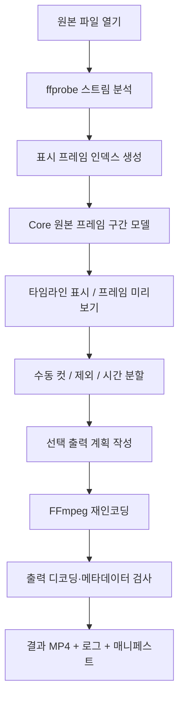

# 02. 아키텍처 초안

## 기술 방향

- Windows 11 / .NET 8 / WPF / MVVM (초기 채택 예정)
- FFmpeg + ffprobe: 프레임 인덱싱, 디코딩/인코딩, 출력 점검
- 순수 .NET 도메인 계층은 FFmpeg와 WPF에 의존하지 않도록 분리.
- UI와 인코딩 프로세스 분리: 긴 작업에도 응답성 유지, 취소/오류 처리.

## 책임 분리

```text
VideoFrameCut.sln
src/
  VideoFrameCut.App/          # WPF 화면, MVVM, 명령, 진행률 바인딩
  VideoFrameCut.Core/         # 순수 편집 모델/프레임 구간/UndoRedo
  VideoFrameCut.Media/        # ffprobe/FFmpeg, 실제 프레임 인덱스, 프리뷰 어댑터
  VideoFrameCut.Export/       # 내보내기 계획, 작업 실행, 검증, 매니페스트
tests/
  VideoFrameCut.Core.Tests/
  VideoFrameCut.Media.Tests/  # 테스트 영상 기반 통합 검증
  VideoFrameCut.Export.Tests/
docs/
```

폴더 구조는 설계안이며 아직 프로젝트 파일이 생성된 상태는 아니다.

## 전체 처리 흐름



## 데이터 모델 초안

```csharp
record SourceMedia(
    string SourcePath,
    string SourceFingerprint,
    VideoStreamInfo Video,
    AudioStreamInfo? Audio);

record DisplayFrame(
    long Index,         // 0부터 시작하는 표시 순서
    long? Pts,          // 원본 비디오 timebase의 정수 PTS
    long? DurationPts); // 유효한 경우에만 채움

record FrameRange(long StartInclusive, long EndExclusive);
record EditSegment(Guid Id, FrameRange Range, bool ExportEnabled);
record ExportPreset(string Name, string Codec, bool KeepAudio);
```

`FrameRange`의 각 경계는 `0 <= start < end <= frameCount`를 만족해야 한다. `FrameCount`와 `PTS`는 같은 값이 아니다. 프레임 인덱스만으로 에디터 결정을 유지하고, 시간 계산은 프레임 메타데이터로 수행한다.

## 주요 컴포넌트

| 컴포넌트 | 역할 |
| --- | --- |
| `MediaProbe` | 메타데이터/스트림 조회 |
| `FrameIndexer` | 실제 표시 프레임별 PTS/순서 수집 및 검증 |
| `FrameTimeline` | 구간 목록 불변식 유지 |
| `EditCommandHistory` | 컷/삭제/토글 실행 취소·재실행 |
| `TimeSplitPlanner` | 대상 범위 내 시간→실제 프레임 경계 스냅 |
| `PreviewDecoder` | 재생 헤드 근처 프레임만 필요 시 디코딩 |
| `ExportPlanner` | 출력 대상·프레임 범위·시간 매핑 고정 |
| `ExportWorker` | 선택한 각 범위 별 FFmpeg 실행, 개별 실패 격리 |
| `OutputVerifier` | 범위·출력 프레임 수·PTS·형식 점검 |
| `ManifestWriter` | JSON/CSV 및 실행 로그 저장 |

## 인터페이스 원칙

- Core에는 UI 컨트롤, FFmpeg CLI 문자열, 프로세스 객체를 넣지 않는다.
- 미리보기의 빠른 탐색과 정확한 최종 컷은 별도 역할. **최종 컷은 프레임 인덱스 기준**.
- ffprobe 인덱싱이 느릴 수 있으므로 백그라운드 작업 + 진행률 + 취소를 허용한다.
- 외부 도구 stdout/stderr는 읽기 스레드가 막히지 않도록 비동기 수집.
- 인코딩 중 작업별 임시 경로에 먼저 쓰고 검증 성공 후 최종 파일명으로 이동하는 정책 검토.
- 라이브러리/CLI 의존성 및 재배포 라이선스는 패키징 전에 점검.

## 첫 구현 순서

1. `FrameRange`, `FrameTimeline`, `TimeSplitPlanner` + 단위 테스트.
2. ffprobe 프레임 인덱스 수집 + CFR/VFR 샘플 테스트.
3. 지정 프레임 범위 추출 + 실제 디코딩 프레임 검증.
4. WPF UI와 미리보기 어댑터 연결.
5. 옵션/오류/진행률/통합 테스트 보강.
